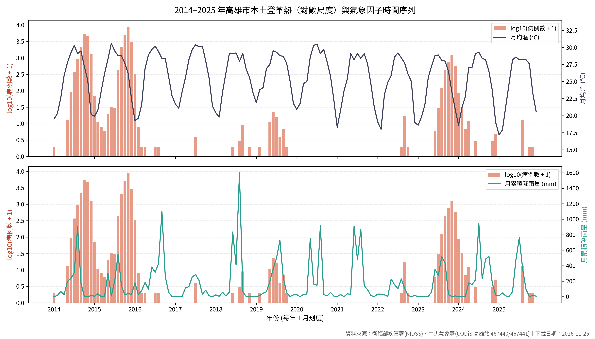

# 高雄市本土登革熱與氣象因子描述性分析（2014–2025）

本專案整理高雄市 2014 年 1 月至 2025 年 12 月（共 144 個月）的本土登革熱確定病例數，搭配同期月均溫與月累積降雨量，進行時間序列、季節輪廓與時間差（Lag）相關性的**描述性**探索，不做因果推論。核心問題如下：

1. **流行週期與分布特徵**：2014–2025 年間高雄本土登革熱呈現什麼樣的流行週期與分布特徵？
2. **季節先後與時間差關聯**：氣溫與降雨量的季節高峰是否早於病例高峰？在不同時間差（Lag 0–4 個月）下的相關強度為何？
3. **跨年度差異**：各年度之間的病例規模與氣象條件有何差異？

## 一、專案目錄結構

```text
dengue-kaohsiung-weather/
├── dengue_weather.ipynb                     # 完整資料清理、統計彙總與視覺化程式碼
├── kaohsiung_dengue_weather_2014_2025.csv  # 清理與合併後之 144 個月主資料集（144 列、7 欄）
├── fig1_timeseries.png                     # 雙軸時間序列圖（線性尺度）
├── fig1b_timeseries_log.png                # 雙軸時間序列圖（log10(cases+1) 對數尺度）
├── fig2_seasonal_profile.png               # 1–12 月季節輪廓圖（2014–2025 平均值 vs 中位數）
├── fig3_lag_correlation.png                # 氣象因子領先 0–4 個月相關係數圖
├── nidss_query.png                         # NIDSS 查詢條件畫面截圖
└── README.md
```

註：在 Colab 執行 notebook 時，資料與圖表會分別輸出至 `data/` 與 `figures/` 資料夾；本倉庫為方便瀏覽，將輸出檔案直接置於根目錄。



原始下載檔未放入本倉庫，重現方式見第二節與第六節。

## 二、資料來源（下載日期：2026-11-25）

| 資料 | 來源 | 使用欄位 |
|---|---|---|
| 登革熱本土確定病例（月） | 衛生福利部疾病管制署 傳染病統計資料查詢系統（NIDSS） | 發病年月、確定病例數 |
| 高雄氣象站逐月資料 | 中央氣象署 CODiS 氣候資料服務系統，測站 467440（2014–2021）、467441（2022–2025） | 氣溫(℃)、降水量(mm) |

**NIDSS 查詢條件**（查詢類別：進階）：疾病＝登革熱；資料期間＝年月 2014-01 至 2025-12；日期種類＝發病日；感染來源＝本土病例；地區別＝高屏區／高雄市／全部。查詢畫面見 [`nidss_query.png`](nidss_query.png)。

篩選檢核：（1）本資料 2025 年合計 14 例，與 NIDSS 同一查詢頁面統計表之「2025年（去年總數）」14 例一致。（2）本資料 2015 年高雄市本土病例合計 19,723 例（依發病年月），量級與衛福部 2015-12-29 新聞稿〈[高雄市登革熱疫情連5週趨緩，持續孳清降低感染風險](https://mohw.gov.tw/cp-16-19710-1.html)〉所公布之高雄市入夏後累計 19,395 例（統計至 12 月 28 日）相近；差異可能來自統計截止日不同（新聞稿為年底前之即時累計，本資料為事後完整資料）及統計範圍（入夏後 vs 全年）。

## 三、清理步驟

1. **病例資料**：NIDSS 查詢時已篩選「高雄市」與「本土」病例（排除境外移入，因其感染地不在高雄，與本地蚊媒及氣象無關）。保留「發病年月」與「確定病例數」兩欄，並拆成年、月。
2. **補齊 144 個月**：建立 2014/01–2025/12 完整年月骨架後合併，無病例月份補 0，避免空值使平均與圖表失真。
3. **氣象資料**：逐年讀取 CODiS 年報表，刪除第 0 列英文欄位代碼，只取「氣溫(℃)」與「降水量(mm)」。
4. **微量降雨**：467441 測站 2022–2024 年資料出現 `T`（微量降雨，< 0.1 mm），以 0.05 mm 代入。對月累積雨量的影響可忽略。
5. **換站處理**：2014–2021 年使用 467440，2022–2025 年使用 467441。舊站 2022 年僅有 1 月資料（2 月起為 `--`），因此 2022 全年改用新站。
6. **合併與檢查**：以「年＋月」合併病例與氣象資料，得到 144 列、0 個缺值。

## 四、主要結果

### 年度彙總（回答第 3 題）

| 年份 | 本土病例 | 單月最高 | 年均溫 (°C) | 年雨量 (mm) |
|---|---:|---:|---:|---:|
| 2014 | 14,999 | 5,328 | 25.6 | 1,942.0 |
| 2015 | 19,723 | 8,914 | 26.1 | 1,344.0 |
| 2016 | 342 | 331 | 25.9 | 3,103.5 |
| 2017 | 3 | 3 | 26.3 | 1,124.5 |
| 2018 | 12 | 8 | 25.9 | 3,068.2 |
| 2019 | 58 | 22 | 26.3 | 2,226.0 |
| 2020 | 0 | 0 | 26.4 | 2,162.5 |
| 2021 | 0 | 0 | 25.4 | 2,600.4 |
| 2022 | 18 | 16 | 24.6 | 945.6 |
| 2023 | 3,145 | 1,222 | 24.8 | 1,679.2 |
| 2024 | 143 | 86 | 25.1 | 2,932.6 |
| 2025 | 14 | 12 | 24.5 | 1,849.0 |

註：2022 年起年均溫偏低，主要反映換站差異，見第五節。

### 時間差相關係數（回答第 2 題）

| 氣象因子領先 | Pearson 氣溫 | Pearson 降雨 | Spearman 氣溫 | Spearman 降雨 |
|---|---:|---:|---:|---:|
| Lag 0（當月） | 0.042 | −0.090 | 0.128 | 0.120 |
| Lag 1 | 0.157 | −0.010 | 0.198 | 0.172 |
| Lag 2 | 0.216 | 0.133 | **0.230** | **0.184** |
| Lag 3 | 0.240 | **0.189** | 0.168 | 0.134 |
| Lag 4 | **0.242** | 0.064 | 0.067 | −0.010 |

### 三點觀察

1. **病例高度集中在少數流行年。** 2014、2015、2023 三年合計 37,867 例，約占 12 年總數 38,457 例的 98.5%。2020、2021 年本土病例為 0，其餘年份多在數十例以內。線性尺度圖幾乎看不到小規模流行，因此另以對數尺度（圖 1B）呈現。
2. **平均值與中位數的高峰月份不同。** 月病例平均值的高峰在 11 月（約 1,245 例），中位數的高峰則在 9 月（3 例），且各月中位數都不超過 3 例。降雨中位數的高峰在 8 月，月均溫高峰在 7 月。這表示：典型年份的少量病例集中在雨季之後約 1 個月；平均值的 10–11 月高峰則主要來自大流行年病例延續到秋季。
3. **氣象因子與病例的相關性弱且不穩定。** 各時間差的相關係數都低於 0.25。最佳時間差也會因方法而改變：Pearson 為氣溫 Lag 3–4、降雨 Lag 3；Spearman 則都是 Lag 2。只能說「氣象季節高峰在時間上早於病例高峰」，無法據此推論氣象造成病例變化。

## 五、限制

- **相關不等於因果**：氣溫與病例都有一年一次的季節循環，高峰相差 3–4 個月時，相關係數自然會在該時間差偏高。從生物學看，卵到成蟲約 1–2 週、病毒在蚊體內的外潛伏期約 1–2 週、人體潛伏期約 3–14 天，總計約數週，並非數個月。
- **極端值與零值**：Pearson 受 2014–2015 年極端月份主導；Spearman 則因超過半數月份病例為 0（中位數＝0）而有大量同值。兩者都需保守解讀。
- **換站造成不連續**：2022 年 1 月兩站同時有資料，舊站月均溫 20.4°C、新站 19.1°C，相差 1.3°C。2022–2025 年年均溫比 2014–2021 年低約 1°C，因此本資料**不能**用來判斷氣溫的長期趨勢。
- **居住地不等於感染地**：NIDSS 以居住縣市統計，在外縣市受感染者也會計入高雄。
- **未納入的重要因素**：病媒蚊密度（布氏指數、誘卵桶）、孳生源調查、病毒血清型與境外輸入、人群免疫、防治措施與人口移動等。
- **單一測站代表全市**：高雄市幅員廣，單一測站無法反映各行政區的微氣候差異。

## 六、重現方式

1. 依第二節條件，從 NIDSS 下載病例 CSV，從 CODiS 下載 467440（2014–2022）與 467441（2022–2025）逐月年報表 CSV。
2. 在 Google Colab 開啟 `dengue_weather.ipynb`，上傳上述 CSV，選擇「執行階段 → 重新啟動並全部執行」。
3. 程式會自動下載 Noto Sans CJK TC 字型以顯示中文。最後的打包下載儲存格僅限 Colab 環境使用。
4. 本專案不使用任何 API key。

## 七、下一步

本練習只能描述「時間上的先後」。若要更嚴謹地分析氣候、病媒蚊與病例之間的關係，需要病媒蚊監測資料，以及能處理季節性、時間差與非線性關係的方法。希望在參與美國 Anastasia Mosquito Control District（AMCD）蚊蟲監測與資料分析實務的過程中，學習以長期監測資料與非線性動態方法進行分析，並回頭應用於臺灣的登革熱資料。
